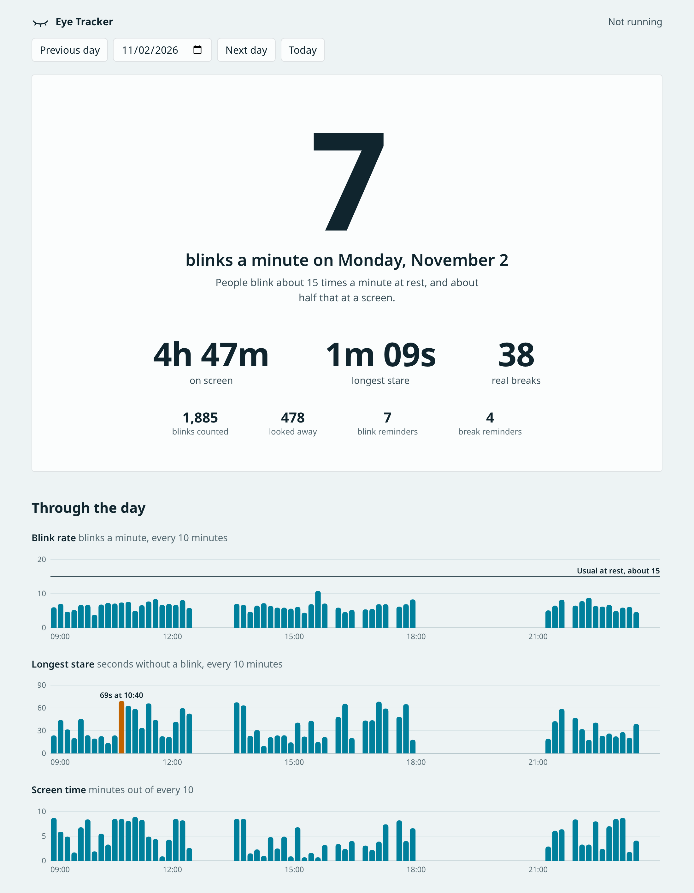

# Eye Tracker

A small Linux tool that uses your webcam to track how often you blink and how
long you stare at the screen. It runs in the background, reminds you to blink
and take breaks, and shows your day on a simple dashboard.

No video or images are ever saved. Each frame is turned into a few numbers and
thrown away, and everything stays on your computer.



## Why

People blink about 15 times a minute normally, and about half that while looking
at a screen. Blinking less dries out your eyes, which causes most of the soreness
and tiredness people get from long days at a computer. You rarely notice it
happening. This tool notices for you.

## What it tracks

| Measure | Meaning |
|---|---|
| Blink rate | Blinks per minute while you face the screen |
| Longest stare | The longest time at the screen without blinking |
| Screen time | Time spent facing the screen |
| Looked away | Times you turned away from the screen for 2 seconds or more |
| Real breaks | Times you were away from the screen for 20 seconds or more |

It also sends a desktop notification:

- after **30 seconds without a blink**
- after **20 minutes of screen time without a real break**

Closing your eyes for a moment counts as a blink, so doing what the reminder
says resets it.

## Requirements

- Linux on a 64-bit Intel or AMD computer
- A webcam
- [uv](https://docs.astral.sh/uv/), which installs the right Python for you
- systemd, if you want it to run in the background (most distros have it)

It works best on GNOME. See [Compatibility](#compatibility) for other desktops.

## Install

Install uv if you don't have it:

```sh
curl -LsSf https://astral.sh/uv/install.sh | sh
```

Then install Eye Tracker:

```sh
git clone https://github.com/vinaytz/EyeTracker.git
cd EyeTracker
uv tool install --python 3.12 .
```

This puts the `eyetracker` command in `~/.local/bin`. If your shell can't find
it, run `uv tool update-shell` and open a new terminal.

## Quick start

**1. Check that it can see you.** This saves nothing.

```sh
eyetracker check
```

Blink about ten times while it runs and compare that with the count it shows.
When it finishes, it reports the frame rate, CPU use and whether it found your
face.

**2. Start tracking in the background.**

```sh
eyetracker install
```

It starts right away and again every time you log in.

**3. Look at your numbers.**

```sh
eyetracker dashboard
```

This opens the charts in your browser. For a quick look in the terminal:

```sh
eyetracker status
```

```
Eye Tracker: tracking, 12 blinks in the last minute

Today
  Blink rate      9.4 a minute
  Screen time     4h 12m
  Longest stare   38s
  Real breaks     6
  Looked away     212 times
  Reminders       3 blink, 1 break
```

## Commands

| Command | What it does |
|---|---|
| `eyetracker check` | Tests the camera and blink detection, saving nothing |
| `eyetracker install` | Runs in the background now and at every login |
| `eyetracker uninstall` | Stops the background service and keeps your stats |
| `eyetracker status` | Shows whether it's running and today's numbers |
| `eyetracker dashboard` | Opens the charts in your browser |
| `eyetracker pause [minutes]` | Turns the camera off for a while, 30 minutes by default |
| `eyetracker resume` | Ends a pause early |
| `eyetracker run` | Tracks in the terminal instead of in the background |

## Video calls

On Linux only one app can use a webcam at a time, so Eye Tracker steps aside
for your calls. It turns the camera off within about 5 seconds when:

- your microphone starts being used
- your screen locks
- you run `eyetracker pause`

It turns the camera back on by itself afterwards.

Some call apps open the camera a moment before the microphone, and may briefly
say the camera is busy. If that happens, retry, or run `eyetracker pause` before
joining.

## Privacy

- Video frames are analysed in memory and discarded straight away.
- Only per-minute totals are saved, in one file:
  `~/.local/share/eyetracker/eyetracker.db`
- The background service has no network access. systemd blocks it.
- The dashboard only accepts connections from your own computer, and loads
  nothing from the internet.

To erase your data, delete `~/.local/share/eyetracker`.

## Settings

Create `~/.config/eyetracker/config.toml` and add only the lines you want to
change. Then restart the service:

```sh
systemctl --user restart eyetracker
```

Available settings and their defaults:

```toml
camera_index = 0               # which camera to use: 0 means /dev/video0
target_fps = 20                # frames analysed per second while you're there
idle_fps = 1                   # frames analysed per second while nobody is
idle_after_s = 10              # seconds without a face before slowing down

pause_when_mic_active = true   # turn the camera off during calls
pause_when_locked = true       # turn the camera off when the screen locks

alerts_enabled = true          # desktop reminders on or off
stare_alert_s = 30             # remind after this many seconds without a blink
stare_alert_cooldown_s = 300   # wait at least this long between blink reminders
break_alert_min = 20           # remind after this many minutes without a break
break_alert_cooldown_min = 5   # wait at least this long between break reminders
break_min_s = 20               # seconds away from the screen that count as a break
```

## Compatibility

Tested on Fedora 44 with GNOME on Wayland. Other systems should run it, with
these differences:

| Feature | Works on | Doesn't work on |
|---|---|---|
| Tracking and dashboard | Most 64-bit Intel and AMD distros | Alpine and other musl-based distros, ARM is untested |
| Pausing when the screen locks | GNOME | KDE, XFCE, Sway, Hyprland and others |
| Pausing during calls | Systems with PipeWire or PulseAudio and a recent `pactl` | Systems without `pactl` |
| Starting at login | GNOME, KDE Plasma | Most window managers, such as i3 and Sway |
| Background service | Distros with systemd | Void, Artix, Gentoo with OpenRC |
| Reminders | Any desktop that shows notifications | Window managers without a notification daemon |

Where a feature doesn't work, the rest keeps working. On other desktops, use
`eyetracker pause` before locking or joining a call. Without systemd, or to start
it from a window manager, run `eyetracker run` from your autostart.

## Resource use

Measured on an Intel Core i5-10300H laptop:

| State | CPU | Memory |
|---|---|---|
| Tracking your face | 40% of one core, about 5% of the whole processor | 185 MB |
| Nobody at the screen | 3% of one core | 180 MB |
| Paused, locked or in a call | 0.3% of one core, camera off | 170 MB |

Nearly all of the tracking cost is the face model. You can set `target_fps = 15`
to save a little CPU, but it misses more short blinks.

The install takes about 500 MB of disk, mostly for the face model's libraries.

## Accuracy

The blink detector was checked against two public-domain videos of a person
speaking to a camera, about 5 minutes in total, with every blink marked by hand.
One video was used to tune the detector and the other was kept back to test it.

| Test | Blinks caught | Detections that were real blinks | Error in the blink count |
|---|---|---|---|
| Tuning video | 94.6% | 97.3% | -0.9% |
| Test video | 93.6% | 94.9% | 0.0% |
| Test video, imitating a cheap webcam at night | 96.2% | 93.8% | +2.6% |

That is one person in good lighting without glasses, so your results may
differ. It gets less accurate with:

- glasses that reflect a lot of light
- a dark room. If `status` warns about a low frame rate, add light on your face.
- a camera far off to one side

Some limits come from using a webcam:

- **Looking away** is judged by where your head points, so glancing with only
  your eyes isn't counted.
- **Real breaks** mean turning away from the screen. A camera can't tell whether
  you looked at something far away.

These are estimates, not medical measurements. If your eyes are often sore or
dry, see an eye doctor.

## Troubleshooting

**"Could not open the camera."** Another app is using it. If Eye Tracker is
running in the background, run `eyetracker pause 1` first.

**"No face found."** Check the camera's privacy shutter or switch, and make sure
your face is lit. If your laptop has more than one camera, try another one with
`camera_index`. Run `ls /dev/video*` to see them. Each camera often appears
twice, so try `0`, then `2`.

**"Frame rate is low."** The camera slows down in dim light, so short blinks get
missed. More light on your face fixes it.

**The camera stays on when I lock the screen.** Lock detection only works on
GNOME. Use `eyetracker pause` instead.

**No reminders appear.** Check that Do Not Disturb is off and that
`alerts_enabled` isn't set to `false`. Window managers need a notification daemon
such as dunst or mako.

**The background service isn't running.** Look at its status and log:

```sh
systemctl --user status eyetracker
journalctl --user -u eyetracker -e
```

**The dashboard says the port is busy.** Use another port:
`eyetracker dashboard --port 8766`.

## Updating and removing

To update, pull the latest code and reinstall:

```sh
cd EyeTracker
git pull
uv tool install --python 3.12 --force .
systemctl --user restart eyetracker
```

To remove everything:

```sh
eyetracker uninstall
uv tool uninstall eyetracker
rm -rf ~/.local/share/eyetracker ~/.config/eyetracker
```

## How it works

```
webcam frame
  -> MediaPipe finds 478 points on your face
  -> eye openness and head direction are worked out, and the frame is discarded
  -> blinks, stares and breaks are counted, and reminders sent
  -> per-minute totals are saved to SQLite
  -> the dashboard reads them
```

**Blinks.** A blink is a quick dip in eye openness compared with your own normal
open-eye level over the last few seconds. Comparing against your own level means
it works for any eye shape, and copes when your expression or posture changes.

**Looking at the screen.** Your head direction is compared with the direction you
usually face. That way a webcam mounted off to one side still works.

**Keeping it light.** The camera is analysed 20 times a second while you're there,
and once a second when nobody is. The model runs on a single core, which roughly
halved its CPU use.

## Development

```sh
git clone https://github.com/vinaytz/EyeTracker.git
cd EyeTracker
uv sync
uv run pytest
```

The tests don't need a camera. Two of them use real detection:

- `tests/test_end_to_end.py` runs generated video through the real face model.
- `tests/test_real_blinks.py` checks the detector against recorded numbers from
  real human blinks.

Where things are:

| File | Job |
|---|---|
| `src/eyetracker/camera.py` | Opens the webcam and keeps its frame rate up in dim light |
| `src/eyetracker/vision.py` | Turns a frame into eye openness and head direction |
| `src/eyetracker/blink.py` | Detects blinks |
| `src/eyetracker/tracker.py` | Counts stares, breaks and looking away, and decides on reminders |
| `src/eyetracker/daemon.py` | The background loop |
| `src/eyetracker/guards.py` | Spots calls, a locked screen and pauses |
| `src/eyetracker/store.py`, `report.py` | Saves and summarises the data |
| `src/eyetracker/dashboard.py`, `static/index.html` | The dashboard |
| `src/eyetracker/cli.py` | The `eyetracker` command |

## Credits

`src/eyetracker/assets/face_landmarker.task` is the Face Landmarker model from
[Google MediaPipe](https://ai.google.dev/edge/mediapipe/solutions/vision/face_landmarker),
used under the Apache License 2.0. Where the test data comes from is described
in `tests/data/README.md`.
